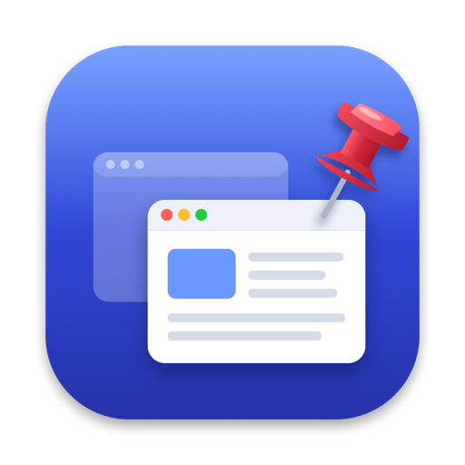

<p align="center">
  
</p>

<h1 align="center">Always On Top</h1>

<p align="center">
  Keep any window above all others on your Mac, and keep using it like a normal window.
</p>

<p align="center">
  
  
  
</p>

---

Pin a video, a calculator, notes or a chat above everything else while you work in other apps. Pinned windows are not frozen pictures: you can click, type and scroll in them as usual. It's a small menu bar app with one shortcut, written in Swift with no dependencies.

## Features

- **One shortcut.** Press **⌃⌥P** to pin or unpin the window you're using.
- **Fully usable pins.** Click a covered pinned window and the click lands where you aimed; scroll it without switching apps.
- **Several at once.** Pin as many windows as you like, each with its own opacity.
- **Plays well with the app.** Sheets, popovers and dialogs of a pinned window show normally.
- **Other desktops.** Pins can follow you to other desktops and over full-screen apps, or stay on their own desktop.
- **Light.** Nothing runs in the background until you pin something.

## Install

Always On Top is built from source; you need macOS 14 or newer and the Xcode command line tools (`xcode-select --install`).

```bash
git clone https://github.com/msinacimen/AlwaysOnTop.git
cd AlwaysOnTop
./build.sh install
```

This builds a universal app, puts it in `/Applications` and opens it. A pin appears in the menu bar. The first launch also turns on **Open at Login**; you can switch that off in the menu.

## Usage

| Action | How |
| --- | --- |
| Pin or unpin the window you're using | **⌃⌥P** (over a pinned window, that one is unpinned) |
| Unpin everything | **⌃⌥⇧P** |
| Pin any open window | Menu bar pin › **Pin Window** |
| Opacity, bring to front, unpin | Menu bar pin › the pinned window's submenu |
| Follow to other desktops, or not | Menu bar pin › **Follow to Other Desktops** |

## Permissions

The app asks for two permissions on first launch. Grant both in **System Settings › Privacy & Security**, then quit and reopen it.

| Permission | Why |
| --- | --- |
| **Screen & System Audio Recording** | To show the pinned window on top (see below). Nothing is saved or sent anywhere. |
| **Accessibility** | To bring the real window forward and pass your clicks to it. |

## How it works

macOS does not let one app raise another app's window above the rest, so Always On Top doesn't try to. Instead it places a borderless floating window exactly over the window you pin and shows a live view of it with ScreenCaptureKit.

- While the real window is in front, the view is click-through, so you're using the actual app.
- When another app covers it, the view is already in place on top, so nothing flickers.
- Clicking the view brings the real window forward and replays your click on it; scrolling is passed straight through.

## Limitations

- **Other desktops are view-only.** macOS doesn't let one app move another app's window between desktops. With **Follow to Other Desktops** on, a pin is visible on other desktops but clicks pass through it there; turn the option off to keep each pin on its own desktop. To use a window everywhere, right-click its app in the Dock and choose **Options › Assign To › All Desktops**.
- **Desktop switches can blink.** The view is a separate window from the real one, and a brief blink can show while macOS slides between desktops.
- **Pins don't survive a restart.** Quitting the app unpins everything.

## Building

```bash
./build.sh            # builds build/AlwaysOnTop.app (universal)
./build.sh install    # also replaces /Applications/AlwaysOnTop.app and relaunches it
```

macOS ties permissions to the app's signature. If a code-signing identity named **AlwaysOnTop Local Signing** is in your keychain, the build is signed with it and permissions survive rebuilds; otherwise it's signed ad hoc and you grant them again after each build. Set `SIGN_IDENTITY` to use another identity.

The icon is drawn in code: `swift Tools/MakeIcon.swift icon.png` renders it at 1024 × 1024.

## Code

| File | What it does |
| --- | --- |
| `Sources/AppDelegate.swift` | Menu bar menu, window discovery, shortcuts, login item |
| `Sources/PinnedWindow.swift` | Live capture, the floating view, cover detection, click hand-off |
| `Sources/Spaces.swift` | Which desktop a window is on, via the window server |
| `Sources/HotKey.swift` | Global shortcuts via Carbon (no Accessibility needed) |
| `Tools/MakeIcon.swift` | Draws the app icon |
